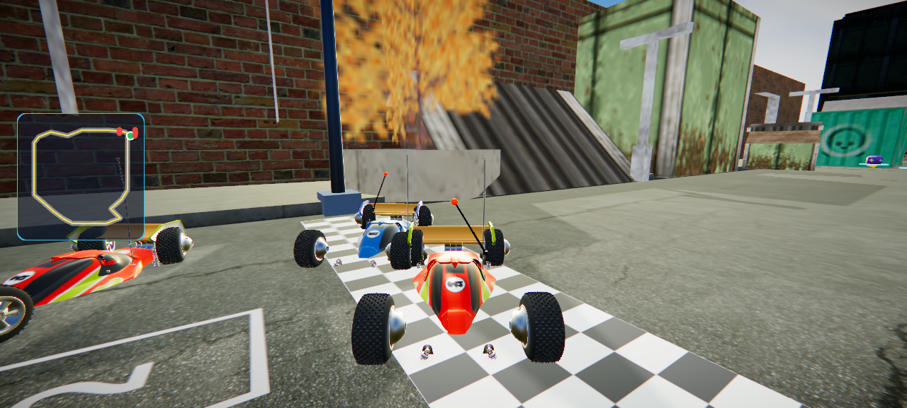
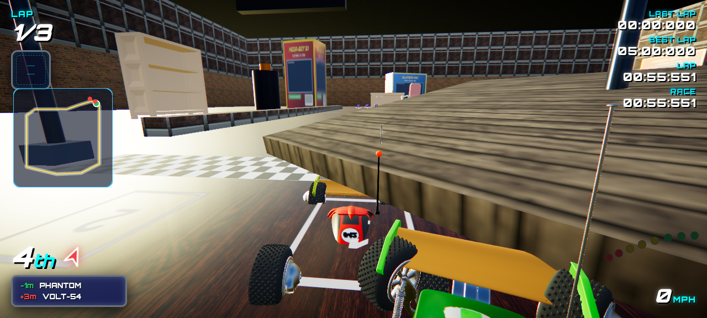
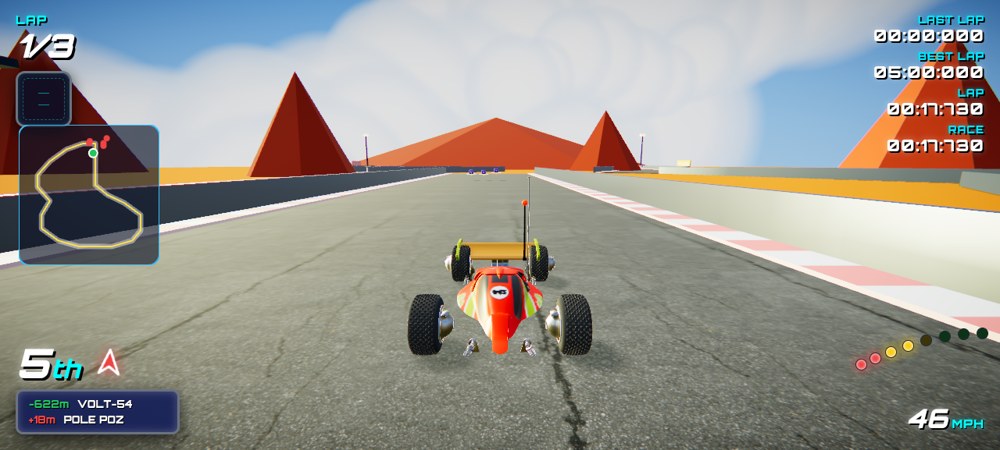

# Micro-Volt RC (3D Arcade Racing Game)

Videojuego de carreras arcade 3D estilo retro (homenaje a clásicos como *Re-Volt* y *Micro Machines*), desarrollado con [Three.js](https://threejs.org/) y simulación física de alta fidelidad con [cannon-es](https://github.com/pmndrs/cannon-es).



---

## Características Principales

- **3 Circuitos Oficiales 3D:**
  1. **Distrito Industrial & Hangar:** Asfalto de alta adherencia, túnel de contenedores marítimos, rampa hacia pasarela elevada (5.2m), puente industrial y chicana de escombros.
  2. **Bodega & Taller de Juguetes:** Circuito miniatura a 2 pisos. Carrera bajo mesas gigantes sobre suelo de madera pulida, rampa ascendente hacia la gran mesa de trabajo (4.5m) y curvas peraltadas.
  3. **Gran Premio del Desierto:** Super Speedway al aire libre entre cañones rocosos, curvas de alta velocidad con pianos rojo/blanco de competición, tribunas y torres de iluminación.
- **Arco de Meta Oficial 3D (`FinishLineArch`):**
  - Pórtico metálico en celosía (*truss*) con cartel luminoso retro `★ START / FINISH ★`.
  - Semáforo interactivo de 4 focos (3 rojos para el conteo 3, 2, 1 y 1 verde para el `¡GO!`) sincronizado con audio y UI.
  - Asfalto con cuadrícula de meta ajedrezada en alta definición.
  - Cajones de salida numerados del #1 al #6 para la parrilla escalonada.
  - Explosión de confeti 3D festivo al cruzar la meta al ganar la carrera.
- **Rivales con IA Competitiva:** 5 corredores rivales autónomos (*Pole Poz*, *Volt-54*, *Adeon*, *Sparky*, *Phantom*) con física idéntica al jugador, trazada inteligente de curvas, bloqueo en grilla durante el conteo y desatascado automático.
- **Física de Buggy RC 4WD:**
  - Tracción integral en las 4 ruedas (50% delantera / 50% trasera) para salida explosiva en la grilla.
  - Centro de gravedad optimizado (`CHASSIS_LIFT = 0.35`) que evita vuelcos accidentales en pianos y curvas cerradas.
  - Sistema de suspensión independiente por raycast (`CANNON.RaycastVehicle`) con amortiguación y compresión regulables.
  - Respawn inteligente con orientación automática hacia el siguiente waypoint con la tecla `R`.
- **Modos de Juego:**
  - **Carrera Rápida (Single Race):** Elige auto y circuito para una competencia directa.
  - **Campeonato RC (Championship):** Gran premio a 3 carreras con tabla de puntuación acumulada.
  - **Contrarreloj (Time Trial):** Corre en solitario para batir el récord del circuito.
  - **Garaje de Exhibición:** Personalización de carrocería, color y dorsal con rotación 360°.
- **Armas y Power-Ups Arcade:**
  - Cajas flotantes en pista con proyectiles de onda expansiva, electro-turbo y aceite deslizante.
- **Cámara Dinámica Multivista:**
  - Alterna entre 3 distancias de cámara en carrera (`KeyC`): Cercana (*Close*), Media (*Medium*) y Lejana (*Far*).

---

## Capturas de Pantalla

| Distrito Industrial | Bodega de Juguetes | GP del Desierto |
| :---: | :---: | :---: |
|  |  |  |

---

## Controles

### Teclado
| Tecla | Acción |
| --- | --- |
| **W / Flecha Arriba** | Acelerar (Adelante) |
| **S / Flecha Abajo** | Frenar / Reversa |
| **A / D / Flechas** | Dirección (Izquierda / Derecha) |
| **Shift** | Turbo / Boost |
| **Espacio** | Freno de mano / Salto |
| **Espacio / Ctrl / E / F** | Disparar arma / Power-up obtenido |
| **C** | Cambiar vista de cámara (Cercana / Media / Lejana) |
| **R** | Respawn inteligente en el waypoint más cercano |
| **Escape** | Menú de Pausa |
| **.** (Punto) | Panel de calibración y telemetría en vivo |

### Gamepad
| Botón | Acción |
| --- | --- |
| **Stick Izquierdo / D-Pad** | Conducción y Dirección |
| **Gatillo Derecho (RT / R2)** | Acelerador analógico |
| **Gatillo Izquierdo (LT / L2)** | Freno / Reversa analógico |
| **A / Cruz** | Salto |
| **B / R1** | Turbo / Boost |

---

## Instalación y Ejecución

Requiere Node.js 18+.

```bash
# Instalar dependencias
npm install

# Iniciar servidor de desarrollo
npm run dev

# Compilar para producción
npm run build
```

El juego estará disponible localmente en `http://localhost:5173/`.

---

## Tecnologías Utilizadas

- **Three.js** (WebGL rendering, shaders de post-procesamiento, sombras en tiempo real, mapas de entorno).
- **cannon-es** (Motor de física rígida, RaycastVehicle, colisionadores continuos AABB).
- **Vite** (Bundler y entorno de desarrollo ultra rápido).
- **lil-gui** (Herramientas de depuración y telemetría en tiempo real).
